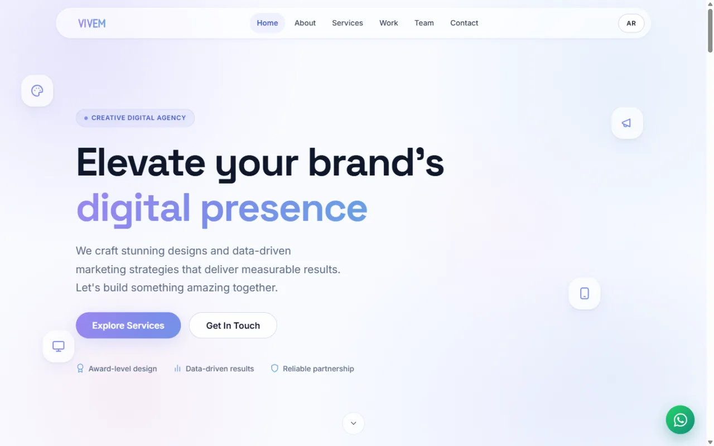
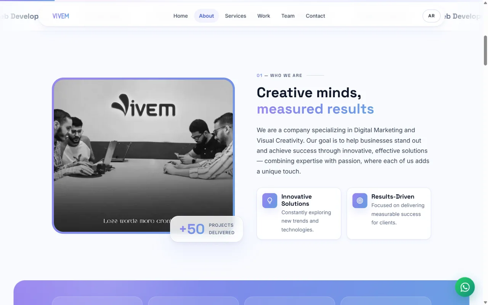
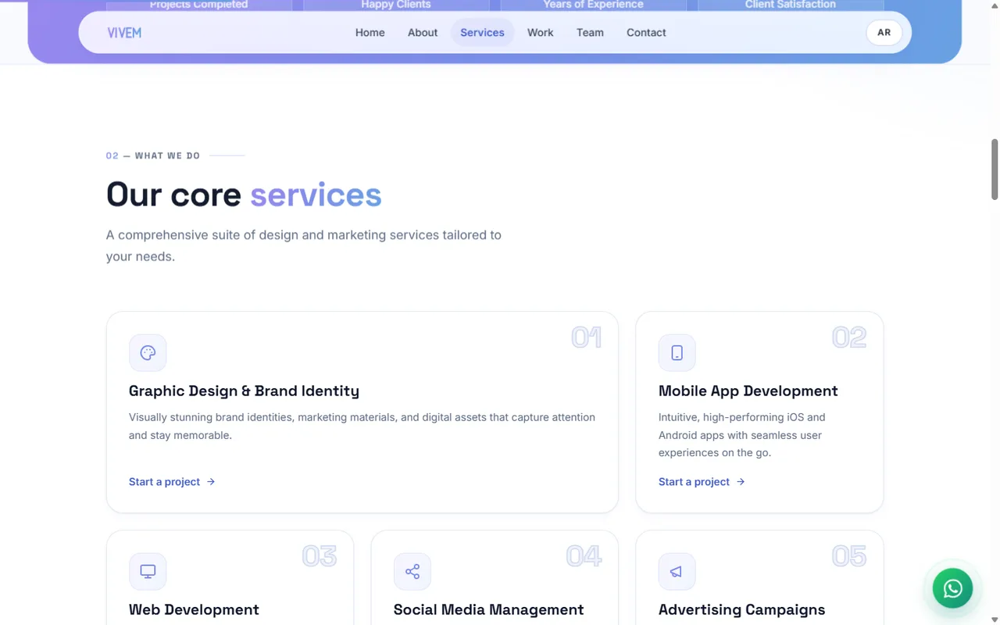
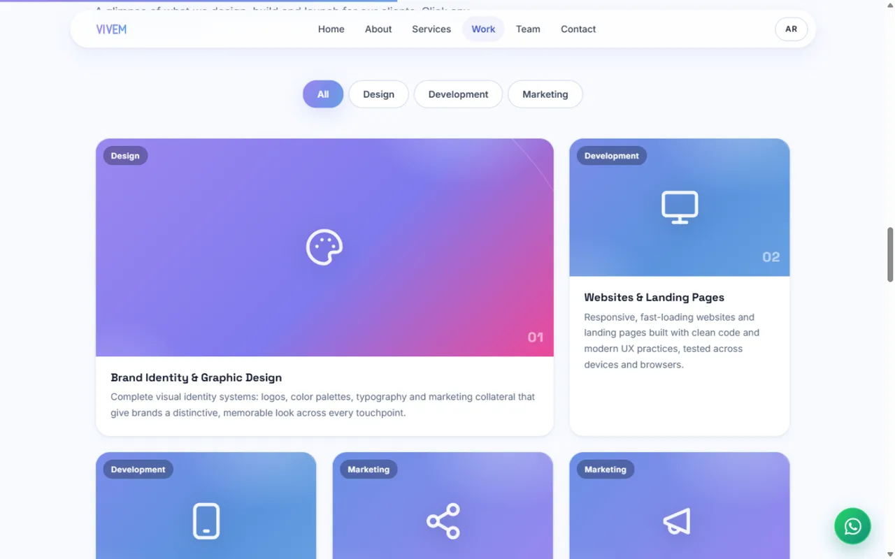
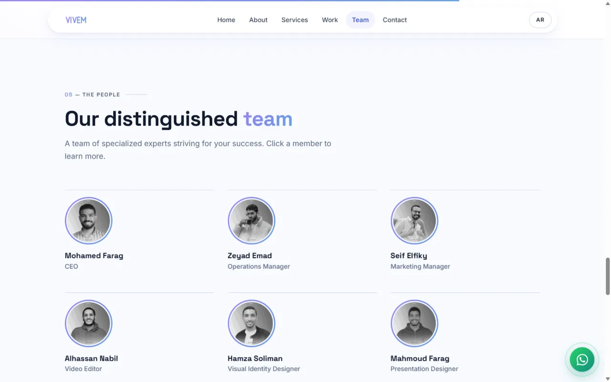
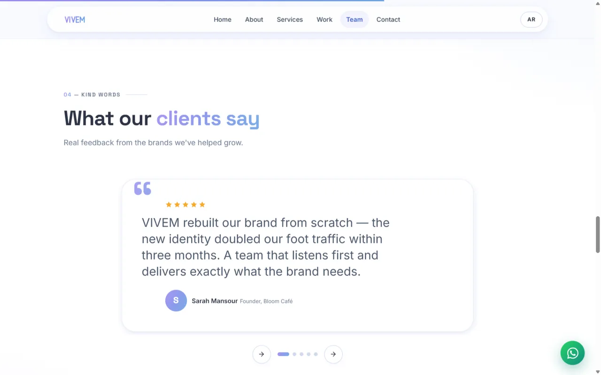
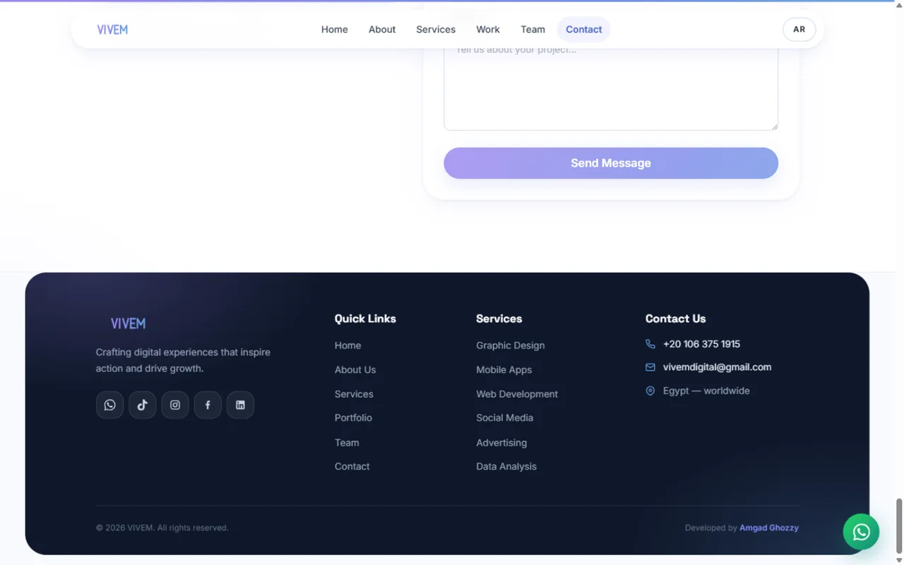
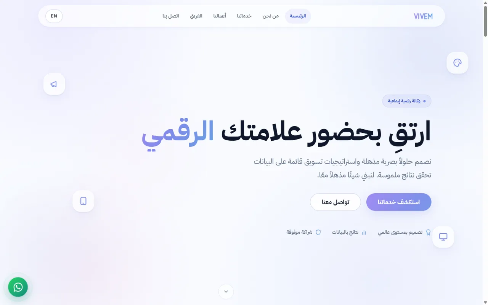
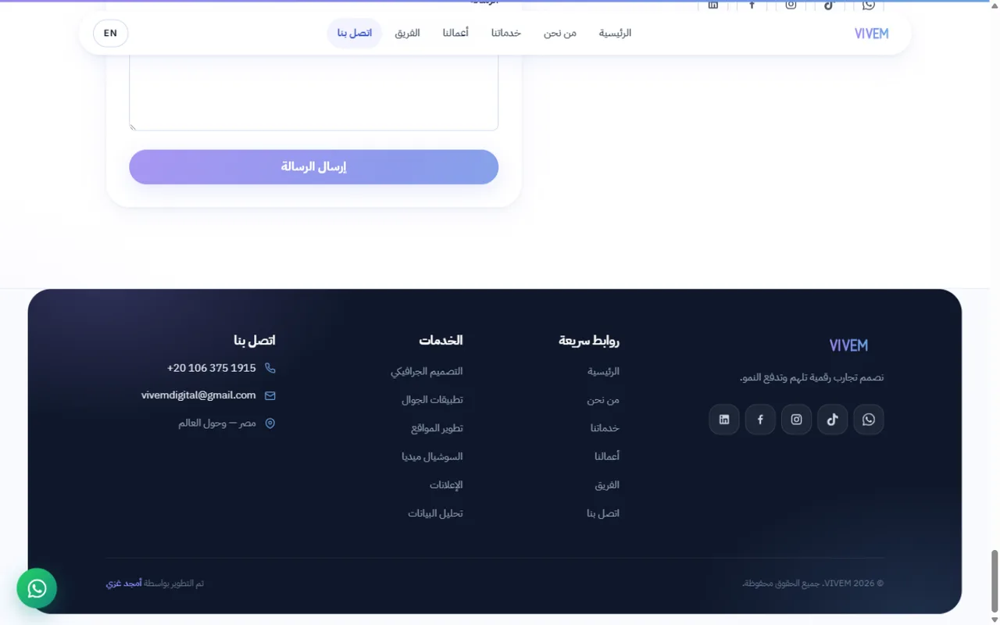
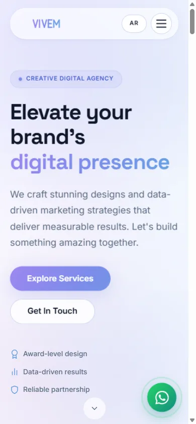

# VIVEM — Aurora Tech Redesign

> Bilingual (EN/AR) creative agency website — vanilla HTML/CSS/JS on Vite, custom "Aurora Tech" design system, fully RTL-aware.
> **Live:** [amgadghozzy.github.io/VIVEM](https://amgadghozzy.github.io/VIVEM/) · **Developer:** [Amgad Ghozzy](https://github.com/AmgadGhozzy)



## ✨ Highlights

| | |
|---|---|
| 🎨 **Custom design system** | Single-token palette (`tokens.css`): narrow-hue aurora gradient (violet → soft blue), glass surfaces, layered shadows — zero hardcoded colors in components |
| 🌍 **True bilingual EN/AR** | One `<html lang>` source of truth; a 3-line head script applies the saved language **before first paint** (no bilingual flash); CSS hides the inactive language with exactly two rules — **zero `!important`** |
| ↔️ **RTL by architecture** | 100% CSS logical properties (`margin-inline`, `inset-inline-start`) — the whole site mirrors with **no duplicated Arabic rule set** |
| 🧩 **Native platform features** | `<dialog>` modals with free focus management, IntersectionObserver reveals & scrollspy, inline SVG sprite (~25 icons, no icon font), self-hosted @fontsource fonts (no Google CDN) |
| ✍️ **Editorial art direction** | Numbered section indexes (٠١ in Arabic), start-aligned oversized type, hairline team grid, featured portfolio card, ghost service numbers — designed against the "generic AI template" look |
| 📸 **Content-driven** | All dynamic content (team, portfolio, testimonials, contact) lives in typed data files — edit `src/data/*.js`, no markup touched |
| ⚡ **Performance-first** | Photography compressed 2.6 MB → ~160 KB (baked aurora monochrome treatment), CSS 39 KB (7.8 KB gzip), JS 28 KB (10.6 KB gzip) |

## 🖼️ Gallery

| About + Stats | Services |
|---|---|
|  |  |
| **Portfolio (featured card + filters)** | **Team (editorial hairline grid)** |
|  |  |
| **Testimonials carousel** | **Contact + floating footer card** |
|  |  |

**Arabic RTL (بالعربي):**

| Hero | Footer |
|---|---|
|  |  |

**Mobile:**



## 🛠️ Stack

- **Build:** Vite 6 (no framework) · GitHub Actions → GitHub Pages
- **Fonts:** Space Grotesk / Inter / IBM Plex Sans Arabic — self-hosted, latin + arabic subsets only
- **Icons:** inline SVG sprite, `currentColor` everywhere

```
├── index.html          # single-page markup (all sections)
├── public/             # served as-is (404, robots, sitemap, CNAME, favicon, OG image)
├── src/
│   ├── styles/         # tokens.css → base → layout → components/*
│   ├── scripts/        # ES modules: i18n, nav, reveal, counters, portfolio,
│   │                   # team, testimonials, contact-form, ui
│   ├── data/           # ★ edit content here: team / portfolio / testimonials / config
│   └── assets/         # compressed webp photography + generated brand logo
├── scripts/            # asset generators (logo/OG/favicon, image pipeline)
└── docs/               # ROADMAP + screenshots
```

## 🚀 Quick start

```bash
npm install
npm run dev        # dev server with HMR
npm run build      # production build → dist/
npm run preview    # preview the build
```

**Receiving form submissions by email:** paste a [Formspree](https://formspree.io) endpoint into `FORM_ENDPOINT` in `src/data/config.js` (falls back to a pre-filled `mailto:` while empty).
**Analytics:** set `VITE_GA_ID=G-XXXXXXXXXX` in `.env` — the GA4 tag injects itself only when the ID exists.

---

## النسخة العربية (ملخص)

موقع وكالة **VIVEM** — ثنائي اللغة (إنجليزي/عربي) بهوية «Aurora Tech» مبنية على نظام توكنز واحد، اتجاه RTL كامل بالـ CSS Logical Properties بدون أي تكرار قواعد، ونظام لغات بدون وميض (سكربت في `<head>` يضبط اللغة قبل الرسم).

- **بدون فريم وورك:** HTML/CSS/JS نقي فوق Vite — نشر تلقائي على GitHub Pages.
- **المحتوى كله في ملفات بيانات:** `src/data/` (الفريق، الأعمال، الشهادات، التواصل) — تعديل بدون لمس الكود.
- **الأداء:** الصور مضغوطة بمعالجة أحادية موحدة، الخطوط self-hosted، صفر CDN خارجي.
- **الأقسام:** Hero تحريري، Marquee، من نحن، إحصائيات، خدمات Bento، أعمال بفلترة وLightbox، شهادات كاروسيل، فريق بنوافذ `<dialog>`، تواصل بفورم مُتحقق، فوتر عائم منحني.

> **ملاحظة النشر:** الدمج إلى `main` يشغّل البناء والنشر تلقائيًا على vivemdigital.com.
